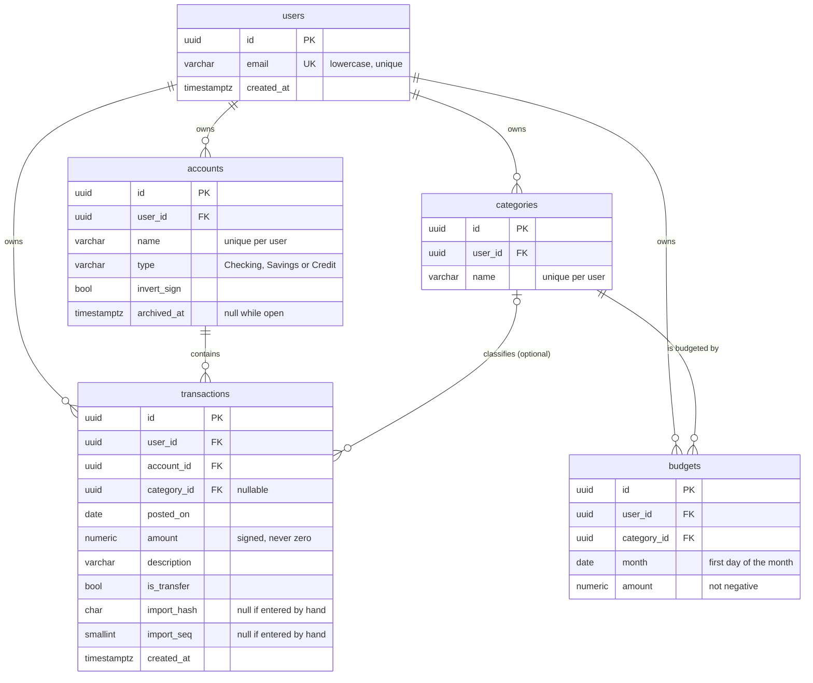

# Budget Tracker

A personal-finance API: import bank transactions, categorize them automatically, and track spending against monthly budgets.

**Status:** milestone 2 of 8 complete: the data model, migrations and database tests are done. The API surface is still just `/health`; see the [roadmap](#roadmap).

## Planned scope

- Accounts, transactions, categories, monthly budgets
- CSV import with duplicate detection
- Rule-based auto-categorization
- Budget vs actual summary per month
- Token auth, per-user data isolation
- Minimal web UI with Playwright end-to-end tests

Deliberately out of scope: bank-API integrations, multi-currency, mobile app.

## Stack

C# / .NET 10 minimal API, PostgreSQL 17 (EF Core), xUnit + Testcontainers, Docker, GitHub Actions.

## Data model



`amount` is `numeric(19,4)`: no floating-point rounding, and negative means money leaving the account. IDs are time-ordered UUIDv7. The schema is defined with EF Core configurations in `src/BudgetTracker.Api/Data/Configurations/`; the generated SQL lives in the migration.

## Design decisions

Each of these is enforced by the database and covered by a test in `tests/BudgetTracker.Api.Tests/Database/`. Several columns (`archived_at`, `invert_sign`, `is_transfer`, the import columns) exist now so later milestones don't need schema rewrites; the behavior that uses them arrives in the milestones noted below.

**Multi-tenant from the first migration.** Every table carries a `user_id`, and uniqueness is scoped to it (two users can both have a "Checking" account). Retrofitting tenancy later means rewriting constraints, indexes and every query, and it is an easy way to leak data, so it is built in before anything uses it.

**The database refuses cross-user references.** A foreign key to `categories(id)` alone would accept another user's category on your transaction. Instead, `accounts` and `categories` have a unique `(user_id, id)`, and `transactions` and `budgets` reference that pair. Even if a future endpoint forgets an ownership check, the write fails. One consequence: when a category is deleted its transactions keep their category as `NULL`, which needs `ON DELETE SET NULL (category_id)` so that `user_id` is left alone. EF Core can only emit `SET NULL` for every column of a composite key, so that one constraint is hand-written SQL in the migration (it requires PostgreSQL 15+). A test proves the behavior, so it cannot silently regress.

**Re-importing a file is safe, and identical rows survive.** CSV rows are identified by a content hash. Hashing alone would treat two real $4.50 coffees on the same day as duplicates and silently drop one, so each row also gets an occurrence number (`import_seq`) within its file. The unique key is `(account_id, import_hash, import_seq)`: re-importing a file is rejected, and a genuine second coffee is kept. Hand-entered transactions have no hash and are never deduplicated. (The import itself arrives in milestone 5.)

**Transfers don't count as spending.** Paying a credit card from checking appears as two transactions in real bank data. Counting the checking side as spending would double-count everything the card paid for, so `is_transfer` excludes a transaction from category spending and budgets. Pairing the two legs of a transfer is the more complete model, but it needs matching logic; it is a possible upgrade, not part of this scope. (Milestone 6.)

**One sign rule for stored amounts.** Banks disagree: many credit card exports show a purchase as a positive number. Rather than infer or ask on every upload, `accounts.invert_sign` is set once per account and import flips the sign, so stored data always follows one rule. A preview step in milestone 5 will show signs before committing, since a wrong sign is a silent error.

**Deletes follow ownership, with archiving for history.** Deleting a user cascades to everything they own, so a user's data can actually be removed. Deleting an account removes its transactions, which is why `accounts.archived_at` exists: closing an old account should hide it without losing history, and hard deletion is for explicit requests. (API behavior in milestone 4.)

**Tests run against real PostgreSQL.** The guarantees above are database behavior (composite keys, check constraints, partial uniqueness), and EF Core's in-memory and SQLite providers ignore or differ on most of them. The tests start one PostgreSQL container, migrate a template database once, and give every test its own copy, so isolation is cheap. One test also fails if the model changes without a matching migration.

**Migrations are a deploy step, not application startup.** CI builds an EF migration bundle and applies it to an empty database, then applies it again to prove it is a no-op. The app never alters its own schema on startup, so its database user needs only data rights, and a bad migration fails the build instead of crashing a boot.

## Develop

```bash
dotnet run --project src/BudgetTracker.Api   # http://localhost:5268/health
dotnet test                                  # needs Docker (Testcontainers starts PostgreSQL)
docker build -t budget-tracker . && docker run -p 8080:8080 budget-tracker
```

### Local database

```bash
docker compose up -d --wait        # PostgreSQL 17 on localhost:5432
dotnet tool restore                # installs the pinned dotnet-ef
ASPNETCORE_ENVIRONMENT=Development dotnet ef database update --project src/BudgetTracker.Api
```

The connection string for local development is in `appsettings.Development.json` and
matches `docker-compose.yml`. Both are for a throwaway local container only.

### Migrations in CI

CI builds an EF migration bundle (`dotnet ef migrations bundle`) and applies it to an empty
PostgreSQL service container, then applies it again to prove a second run is a no-op. The
bundle is uploaded as a build artifact. Deploys will run the bundle before the app starts.

## Roadmap

1. ~~Skeleton and CI~~
2. ~~Data model and migrations~~
3. Auth ← next
4. Core CRUD API
5. CSV import with dedup
6. Categorization rules and budgets
7. UI and E2E tests
8. Deploy and write-up
