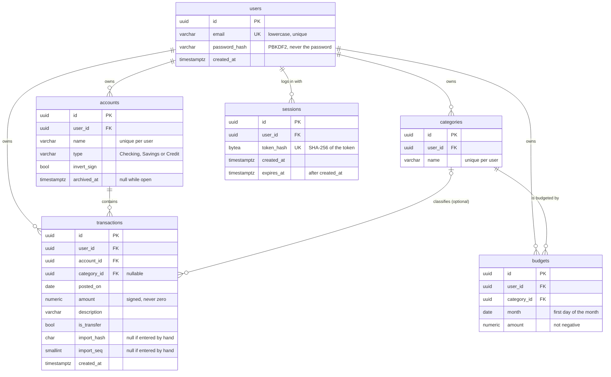

# Budget Tracker

A personal-finance API: import bank transactions, categorize them automatically, and track spending against monthly budgets.

**Status:** milestone 4 of 8 complete. The data model, authentication and the core CRUD API are done and tested: you can register, log in, manage categories and accounts, and add, edit, filter and page through transactions. CSV import and budgets come next; see the [roadmap](#roadmap).

## Planned scope

- Accounts, transactions, categories, monthly budgets
- CSV import with duplicate detection
- Rule-based auto-categorization
- Budget vs actual summary per month
- Token auth, per-user data isolation
- Minimal web UI with Playwright end-to-end tests

Deliberately out of scope: bank-API integrations, multi-currency, mobile app.

## Stack

C# / .NET 10 minimal API, PostgreSQL 17 (EF Core), OpenAPI with the Scalar explorer, xUnit + Testcontainers, Docker, GitHub Actions.

## API

Everything except register, login and health needs `Authorization: Bearer <token>`. The OpenAPI document lists every status code below (see the [API explorer](#api-explorer)).

### Authentication and account

| Endpoint | Auth | Responses |
| --- | --- | --- |
| `POST /auth/register` | none | 201, 400, 404 (registration off), 409 (email taken), 429 |
| `POST /auth/login` | none | 200 with a bearer token, 400, 401, 429 |
| `POST /auth/logout` | bearer | 204, 401 |
| `GET /me` | bearer | 200, 401 |
| `DELETE /me` | bearer + password in the body | 204, 400, 401, 403 (wrong password), 429 |
| `GET /health` | none | 200 |

### Categories, accounts and transactions

| Endpoint | Responses |
| --- | --- |
| `GET /categories` | 200, ordered by name (not paginated) |
| `POST /categories` | 201, 400, 409 (name taken) |
| `GET`, `PUT`, `DELETE /categories/{id}` | 200 or 204, 400, 404, 409 |
| `GET /accounts` | 200; archived accounts only with `?includeArchived=true` |
| `POST /accounts` | 201, 400, 409 (name taken) |
| `GET`, `PUT /accounts/{id}` | 200, 400, 404, 409 |
| `DELETE /accounts/{id}` | 204 archives it; `?permanent=true` deletes it for good (409 unless already archived) |
| `POST /accounts/{id}/unarchive` | 200, 404 |
| `GET /transactions` | 200 with `{ items, nextCursor }`; [filters and pagination](#pagination) |
| `POST /transactions` | 201, 400, 409 (account archived), 422 (account or category missing or not yours) |
| `GET`, `PUT`, `DELETE /transactions/{id}` | 200 or 204, 400, 404, 409, 422 |

Errors are [RFC 9457](https://www.rfc-editor.org/rfc/rfc9457) problem responses with a stable `code` you can switch on. Validation errors add a per-field `errors` map and a matching `codes` map:

```json
{ "title": "That email is already registered.", "status": 409, "code": "email.taken" }
{ "title": "One or more validation errors occurred.", "status": 400,
  "errors": { "amount": ["Amount may have at most 4 decimal places."] },
  "codes":  { "amount": ["amount.too_precise"] } }
```

```bash
H='content-type: application/json'

curl -X POST localhost:5268/auth/register -H "$H" \
  -d '{"email":"you@example.com","password":"correct horse battery staple"}'
TOKEN=$(curl -s -X POST localhost:5268/auth/login -H "$H" \
  -d '{"email":"you@example.com","password":"correct horse battery staple"}' | jq -r .token)
A="authorization: Bearer $TOKEN"

curl -X POST localhost:5268/categories -H "$H" -H "$A" -d '{"name":"Groceries"}'
curl -X POST localhost:5268/accounts   -H "$H" -H "$A" -d '{"name":"Everyday","type":"Checking"}'

# Amounts are signed JSON numbers: negative is money leaving the account.
curl -X POST localhost:5268/transactions -H "$H" -H "$A" \
  -d '{"accountId":"<account id>","postedOn":"2026-10-01","amount":-12.50,"description":"milk"}'

# Newest first, two at a time; pass nextCursor back as cursor for the next page.
curl "localhost:5268/transactions?limit=2" -H "$A"
curl "localhost:5268/transactions?limit=2&cursor=<nextCursor>" -H "$A"
```

### Pagination

`GET /transactions` returns your transactions newest first (posted date, then id, both descending) as `{ "items": [...], "nextCursor": "..." }`. Pass `nextCursor` back as `cursor` to get the next page; it is `null` on the last page. `limit` defaults to 50 and is clamped to 100 (below 1 is a 400). The cursor is opaque: treat it as a string and do not build one yourself.

Filters, all combined with AND: `accountId`, `categoryId`, `from` and `to` (inclusive, written `yyyy-MM-dd`) and `isTransfer`. Filtering by an id that is not yours finds nothing rather than failing.

### API explorer

With `Documentation:Enabled` the app serves the OpenAPI document at `/openapi/v1.json` and the Scalar explorer at `/scalar/v1`. Both are off by default and on in Development, so the public demo does not expose them. Tests pin the document's content: every endpoint, every documented status code, and which operations require the bearer scheme.

### Configuration

Any setting can also be an environment variable, with `__` for `:` (for example `Registration__Enabled=true`).

| Setting | Default | Meaning |
| --- | --- | --- |
| `ConnectionStrings:Default` | none | PostgreSQL connection string |
| `Registration:Enabled` | off (on in Development) | Whether `POST /auth/register` works; otherwise 404 |
| `Documentation:Enabled` | off (on in Development) | OpenAPI document and Scalar explorer |
| `Sessions:LifetimeDays` | 14 | Absolute session lifetime (1 to 365) |
| `Sessions:MaxPerUser` | 10 | Active sessions per user (1 to 1000) |
| `Sessions:PurgeIntervalMinutes` | 60 | How often expired sessions are deleted (1 to 1440) |
| `RateLimiting:Auth:PermitLimit` | 10 | Register, login and account-deletion attempts per window per client address |
| `RateLimiting:Auth:WindowSeconds` | 60 | The rate-limit window |

Out-of-range session settings stop the app at startup instead of failing later.

## Data model



`amount` is `numeric(19,4)`: no floating-point rounding, and negative means money leaving the account. IDs are time-ordered UUIDv7. The newest-first transaction list is served by an index on `(user_id, posted_on DESC, id DESC)`; a test checks that the query planner uses it without a sort. The schema is defined with EF Core configurations in `src/BudgetTracker.Api/Data/Configurations/`; the generated SQL lives in the migrations.

## Design decisions

Each of these is enforced by the database or the application and covered by a test. Several columns (`archived_at`, `invert_sign`, `is_transfer`, the import columns) exist now so later milestones don't need schema rewrites; the behavior that uses them arrives in the milestones noted below.

### Data

**Multi-tenant from the first migration.** Every table carries a `user_id`, and uniqueness is scoped to it (two users can both have a "Checking" account). Retrofitting tenancy later means rewriting constraints, indexes and every query, and it is an easy way to leak data, so it is built in before anything uses it.

**The database refuses cross-user references.** A foreign key to `categories(id)` alone would accept another user's category on your transaction. Instead, `accounts` and `categories` have a unique `(user_id, id)`, and `transactions` and `budgets` reference that pair. Even if a future endpoint forgets an ownership check, the write fails. One consequence: when a category is deleted its transactions keep their category as `NULL`, which needs `ON DELETE SET NULL (category_id)` so that `user_id` is left alone. EF Core can only emit `SET NULL` for every column of a composite key, so that one constraint is hand-written SQL in the migration (it requires PostgreSQL 15+). A test proves the behavior, so it cannot silently regress.

**Re-importing a file is safe, and identical rows survive.** CSV rows are identified by a content hash. Hashing alone would treat two real $4.50 coffees on the same day as duplicates and silently drop one, so each row also gets an occurrence number (`import_seq`) within its file. The unique key is `(account_id, import_hash, import_seq)`: re-importing a file is rejected, and a genuine second coffee is kept. Hand-entered transactions have no hash and are never deduplicated. (The import itself arrives in milestone 5.)

**Transfers don't count as spending.** Paying a credit card from checking appears as two transactions in real bank data. Counting the checking side as spending would double-count everything the card paid for, so `is_transfer` excludes a transaction from category spending and budgets. Pairing the two legs of a transfer is the more complete model, but it needs matching logic; it is a possible upgrade, not part of this scope. (Milestone 6.)

**One sign rule for stored amounts.** Banks disagree: many credit card exports show a purchase as a positive number. Rather than infer or ask on every upload, `accounts.invert_sign` is set once per account and import flips the sign, so stored data always follows one rule. A preview step in milestone 5 will show signs before committing, since a wrong sign is a silent error.

**Deletes follow ownership, with archiving for history.** Deleting a user cascades to everything they own, so a user's data can actually be removed. Deleting an account removes its transactions, which is why `accounts.archived_at` exists: closing an old account should hide it without losing history, and hard deletion is for explicit requests. (The API side is described under [The finance API](#the-finance-api).)

### Authentication

**Sessions are opaque tokens in the database, not JWTs.** A login returns 32 random bytes (base64url); only their SHA-256 is stored, so a leaked database does not hand out usable tokens. A fast hash is fine there, unlike for passwords, because the input is 256 bits of randomness. The point of choosing this over JWTs is revocation: logout is one row delete, deleting an account removes its sessions through the existing cascade, and there are no signing keys and no refresh-token rotation to get wrong. The cost is one indexed lookup per request. A stateless JWT would avoid that and scale across instances more simply; at this scale the simplicity is worth more.

**Hand-rolled on the `users` table.** ASP.NET Identity brings its own schema and would have to be reconciled with the tenancy root every foreign key points at, and an external provider would stop the demo from running on its own. Passwords use the framework's `PasswordHasher` (PBKDF2, a random salt per hash, parameters stored in the hash so they can be raised later; a login with an outdated hash upgrades it).

**Login reveals nothing.** An unknown email and a wrong password return the identical 401. When the email is unknown, a dummy hash is verified anyway so the response time does not give the email away, and the registration password rules are not applied at login so it cannot hint at the policy. Guessing is slowed by a per-address rate limit rather than per-account lockout, because lockout lets anyone lock a victim out by guessing their email. The tradeoff that remains: `POST /auth/register` returns 409 for a taken email, which does reveal which emails are registered. Without email verification there is no way to avoid that.

**Passwords: length over complexity.** 12 to 128 characters counted as Unicode characters, no composition rules (following NIST guidance), and a bundled list of common passwords is rejected. The maximum exists so a huge request cannot burn CPU in the hasher. Emails are trimmed and lowercased, matching a database check, but never rewritten per provider (no stripping of `+tags` or dots).

**Sessions have a fixed lifetime, a cap and a purge.** Sessions last 14 days from login with no sliding extension, so authenticating never writes. A user can hold 10; the eleventh login evicts the oldest, in the same transaction and under a row lock on the user so that simultaneous logins cannot miscount. Expired sessions never authenticate whether or not their rows are deleted yet, and an hourly background job deletes them. That job survives failures: an exception escaping a `BackgroundService` stops the whole host, so one database hiccup must not take the API down.

**Account deletion is real.** `DELETE /me` requires the password and removes the user and everything they own in one statement (the cascades do the rest, sessions included, so the request's own token dies with it). A wrong password is a 403, not a 401, because the session is fine and only a confirmation failed. It shares the login rate-limit budget: re-entering the password makes it a password oracle, and a stolen token must not buy unlimited guesses.

**Constraint violations become API errors in one place.** The database is the source of truth, so there is no check-then-insert race: two simultaneous registrations of one email produce one user and a clean 409 for the other. A single table maps constraint names to status codes and error codes.

**Time is injected.** Everything that depends on the clock (expiry, the purge interval, the cap) reads `TimeProvider`, so tests move time instead of waiting on it.

### The finance API

**Someone else's data does not exist.** A resource that belongs to another user returns the same 404 as one that was never created, so ids cannot be used to probe what exists. Referring to someone else's account or category in a request body is refused by the database itself, through the composite foreign keys, and comes back as a 422; the application only pre-checks whether the caller's own account is archived. The answer is deliberately the same whether or not the other user's account is archived: a 409 there would confirm it exists. A single test has two users attack each other through every endpoint and cross-reference and then checks that every row of every table is unchanged; mutating only the archived-account lookup made that test, and nothing else, fail.

**Lists are paginated by keyset, not by offset.** Page N costs the same as page 1, because each page continues from the last item's `(posted_on, id)` along an index instead of counting rows to skip. It is also stable: a transaction that arrives between two requests never causes a repeat or a gap, which offsets cannot promise. The tie-break on `id` matters because many transactions share a date, and the tests page through heavily tied data and compare against the order PostgreSQL itself produces (.NET and PostgreSQL order UUIDs differently, so sorting in C# would not be a trustworthy expectation). The tradeoff: no jumping to page 47 and no total count. Categories and accounts are not paginated, since a user has a handful of each.

**Archived accounts are frozen, in both directions.** Nothing can be added to one, edited in one, moved out of one, moved into one or deleted from one (409), but its history stays readable and `unarchive` reopens it. Permanent deletion takes two deliberate steps: archive, then `DELETE ?permanent=true`.

**Inputs are strict, and nothing is silently adjusted.** Amounts must be JSON numbers (a string is a 400, a global setting, since ASP.NET accepts `"12.50"` by default), not zero, below 10^15, and with at most four decimal places. Too many decimals are refused rather than rounded, because quietly changing a money amount is never right. Dates are exactly `yyyy-MM-dd`. Account types are the exact names `Checking`, `Savings` or `Credit`: a first version using `Enum.TryParse` would have accepted `"Checking, Savings"` and OR-ed the values, which a test now pins. Names and descriptions are trimmed, reject control characters, and are limited by Unicode characters, so 100 emoji fit a `varchar(100)`.

**Updates replace the whole resource.** `PUT` sends everything; an omitted optional field returns to its default, and `archivedAt` cannot be changed through `PUT`. There is no optimistic concurrency: two simultaneous edits of one resource are last-write-wins. The upgrade path is an ETag from PostgreSQL's `xmin` with `If-Match` returning 412.

**Constraint failures are API errors, in one table.** Duplicate names are 409s (`category.name_taken`, `account.name_taken`) and unusable references are 422s (`account.invalid`, `category.invalid`). Two simultaneous creates of the same name produce one resource and one clean 409.

### Testing

**Tests run against real PostgreSQL.** The guarantees above are database behavior (composite keys, check constraints, partial uniqueness, row locks), and EF Core's in-memory and SQLite providers ignore or differ on most of them. The tests start one PostgreSQL container, migrate a template database once, and give every test its own copy, so isolation is cheap. API tests drive the real application over HTTP against that database. Most authenticated tests insert a session row directly and send its token, so they skip the deliberately slow password hashing but still go through the real authentication handler; the auth behavior itself is tested once, thoroughly, through the real endpoints. One test also fails if the model changes without a matching migration.

**Migrations are a deploy step, not application startup.** CI builds an EF migration bundle and applies it to an empty database, then applies it again to prove it is a no-op. The app never alters its own schema on startup, so its database user needs only data rights, and a bad migration fails the build instead of crashing a boot.

## Deliberate cuts and upgrade paths

- **Not built:** email verification, password reset, multi-factor and social login. Password reset needs email infrastructure, which is not worth it for this scope.
- **Registration reveals taken emails** (see above); unavoidable without verification.
- **`DELETE /me` carries a JSON body.** Some clients and proxies drop request bodies on DELETE; the result is a clean 400, not data loss.
- **The rate limit keys on the client address.** Behind a reverse proxy that is the proxy's address unless forwarded headers are configured, which is a deployment step (milestone 8).
- **Browser token storage is undecided** until the UI exists (milestone 7); today the token is sent in the `Authorization` header.
- **Category and account names are case-sensitive:** "Food" and "food" can coexist, as the schema defines. Case-insensitive uniqueness would need a schema change.
- **No optimistic concurrency, bulk operations, text search or "uncategorized only" filter.** The categorization milestone will add what it needs.
- **Upgrade paths:** Argon2id for password hashing, a breached-password check against the Have I Been Pwned range API, sliding sessions, and a `/v2` route prefix if a second API consumer ever appears.

## Develop

```bash
dotnet run --project src/BudgetTracker.Api   # http://localhost:5268, Development settings
dotnet test                                  # needs Docker (Testcontainers starts PostgreSQL)
docker build -t budget-tracker . && docker run -p 8080:8080 budget-tracker
```

### Local database

```bash
docker compose up -d --wait        # PostgreSQL 17 on localhost:5432
dotnet tool restore                # installs the pinned dotnet-ef
ASPNETCORE_ENVIRONMENT=Development dotnet ef database update --project src/BudgetTracker.Api
```

The connection string for local development is in `appsettings.Development.json` and matches `docker-compose.yml`. Both are for a throwaway local container only. In Development, registration and the API explorer are on, so after the commands above you can register and log in with the `curl` examples and open `http://localhost:5268/scalar/v1`.

### Migrations in CI

CI builds an EF migration bundle (`dotnet ef migrations bundle`) and applies it to an empty PostgreSQL service container, then applies it again to prove a second run is a no-op. The bundle is uploaded as a build artifact. Deploys will run the bundle before the app starts.

## Credits

The common-password check uses passwords of 12 or more characters from the Pwdb top-100000 list in [SecLists](https://github.com/danielmiessler/SecLists) (MIT licensed), lowercased and embedded as a resource.

## Roadmap

1. ~~Skeleton and CI~~
2. ~~Data model and migrations~~
3. ~~Auth~~
4. ~~Core CRUD API~~
5. CSV import with dedup ← next
6. Categorization rules and budgets
7. UI and E2E tests
8. Deploy and write-up
